<div align="center">

# MWS

**A local AWS that unmodified SDKs can't tell apart from the real thing.**

[](https://github.com/terminalsin/mws/actions/workflows/ci.yml)
[](#license)
[](https://www.rust-lang.org)
[](docs/services/README.md)

[Getting started](docs/getting-started.md) ·
[Services](docs/services/README.md) ·
[Configuration](docs/configuration.md) ·
[Architecture](docs/architecture.md) ·
[Contributing](CONTRIBUTING.md)

</div>

---

MWS is a spec-faithful AWS emulator written in Rust. Point any official AWS
SDK or the AWS CLI at `http://localhost:4566` and it speaks the same wire
protocols, enforces the same validation rules, checks the same SigV4
signatures, evaluates the same IAM policies and returns the same error codes
and messages as AWS.

It is built for testing, not for production traffic. The question MWS answers
is: *would this code work against AWS?* Fidelity beats breadth, so every
service is generated from AWS's official Smithy model and verified with the
real Rust, Python and JavaScript SDKs.


> [!NOTE]
> Open sourcing this since it is completely pointless as it has been replaced by [AWS Emulator](https://github.com/aws/aws-emulator) 

## Highlights

- **No mocks, no patches.** Your code uses the stock SDK. The only change is
  the endpoint (`AWS_ENDPOINT_URL`), exactly as it would be in a deployed
  environment.
- **Real security.** Every request needs a valid SigV4 signature. Every call to
  every service is authorized by a full IAM policy engine: identity and
  resource policies, permissions boundaries, session policies, SCPs and RCPs,
  ABAC tag conditions and cross-account access.
- **Generated from the AWS models.** Request and response shapes, routing and
  validation come from the official Smithy models across six protocols
  (awsQuery, awsJson, restXml, restJson1, Smithy RPC v2 CBOR and ec2Query).
- **Things actually happen.** KMS keys do real cryptography, Private CA and
  ACM issue real X.509 certificates, Lambda functions run in AWS's own runtime
  images, and with Docker, EC2 instances, ECS tasks, RDS databases,
  ElastiCache nodes and EKS API servers really run. Load balancers proxy real
  traffic, ECR is a real registry, CodeArtifact serves real package managers,
  and events flow between services as they do on AWS: S3 notifications reach
  SNS, SQS and Lambda; alarms page through SNS; Firehose delivers to S3;
  CloudTrail records every call.
- **Asynchronous where AWS is.** Instances start `pending`, certificates
  wait for issuance, replication reports `PENDING` and stacks move through
  `CREATE_IN_PROGRESS`, all on an emulated clock, so code that skips the SDK
  waiters fails locally as it would on AWS.
- **Built for test suites.** In memory by default, with optional SQLite
  persistence, declarative seed scenarios, instant resets, named snapshots and
  an emulated clock you can move forward.
- **Strictly modular.** One crate per service, generic infrastructure crates
  that never name a service, and cross-service behaviour only where AWS itself
  couples services.

## A look inside

MWS ships with a [web console](docs/dashboard.md) in the AWS console's layout.
Everything below is MWS answering the same SDK calls AWS would; the
screenshots come from [a seeded demo account](docs/screenshots/seed.py).

<table>
  <tr>
    <td width="33%" valign="top">
      <a href="docs/screenshots/home.webp">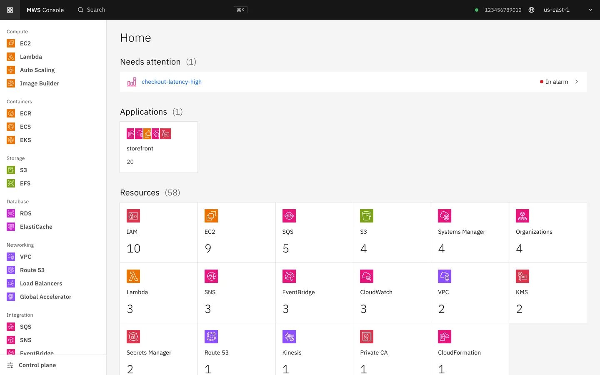</a>
      <br><b>Every resource at a glance</b>
      <br><sub>Resources grouped into applications by tag, with anything that needs attention first.</sub>
    </td>
    <td width="33%" valign="top">
      <a href="docs/screenshots/search.webp">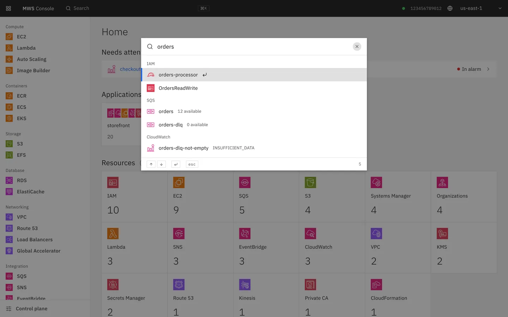</a>
      <br><b>⌘K search</b>
      <br><sub>One search box across every resource in every service.</sub>
    </td>
    <td width="33%" valign="top">
      <a href="docs/screenshots/create-form.webp">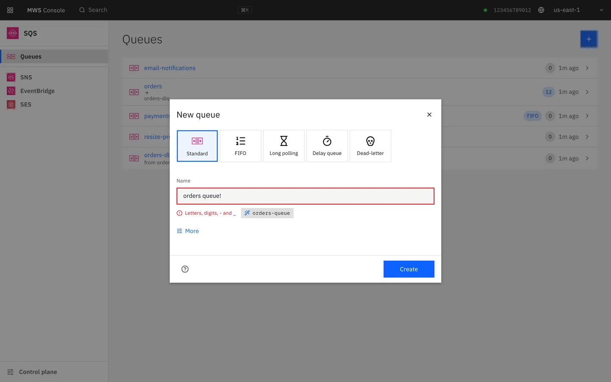</a>
      <br><b>Forms that repair themselves</b>
      <br><sub>Smithy constraints checked as you type, with a one-click fix.</sub>
    </td>
  </tr>
  <tr>
    <td width="33%" valign="top">
      <a href="docs/screenshots/iam-policy.webp">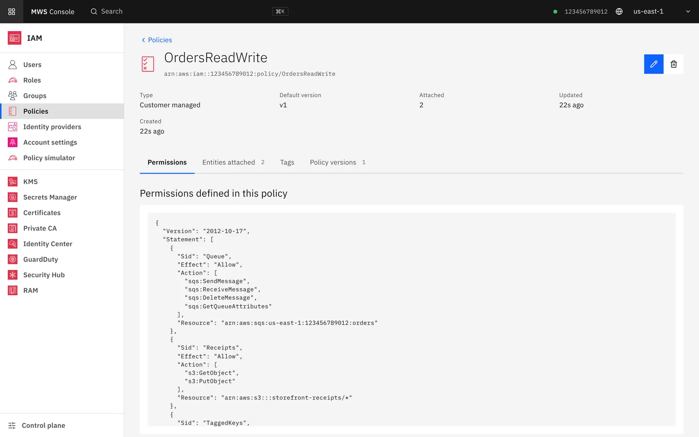</a>
      <br><b>Real IAM policies</b>
      <br><sub>Customer managed policies, versions and attachments, as AWS stores them.</sub>
    </td>
    <td width="33%" valign="top">
      <a href="docs/screenshots/iam-simulator.webp">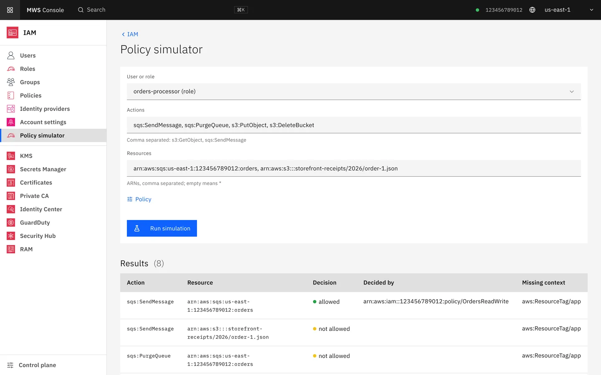</a>
      <br><b>Policy simulator</b>
      <br><sub>The same engine that authorizes every call explains each decision.</sub>
    </td>
    <td width="33%" valign="top">
      <a href="docs/screenshots/organizations.webp">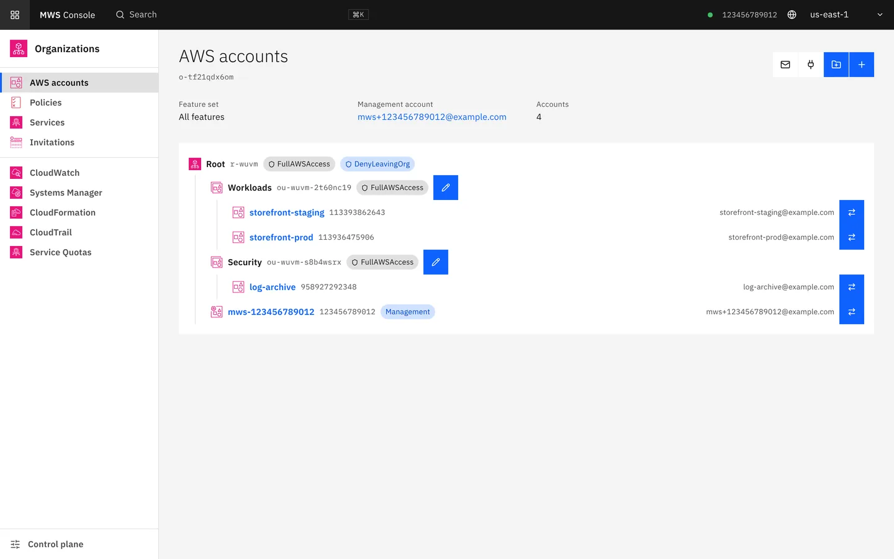</a>
      <br><b>Organizations</b>
      <br><sub>Member accounts, OUs and SCPs that are enforced on every request.</sub>
    </td>
  </tr>
  <tr>
    <td width="33%" valign="top">
      <a href="docs/screenshots/kms-key.webp">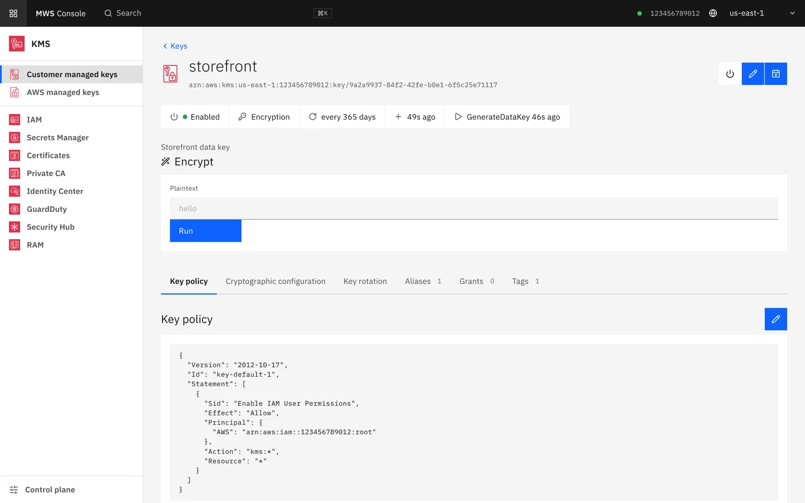</a>
      <br><b>KMS</b>
      <br><sub>Real cryptography, key policies, grants and automatic rotation.</sub>
    </td>
    <td width="33%" valign="top">
      <a href="docs/screenshots/pca.webp">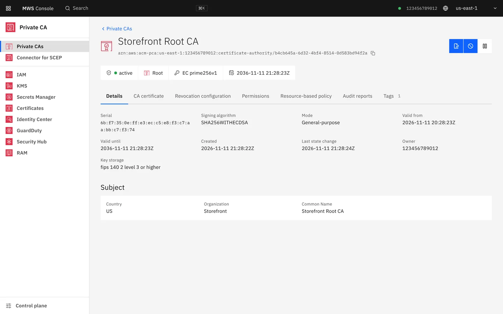</a>
      <br><b>Private CA</b>
      <br><sub>Real X.509 hierarchies with CRLs, OCSP and audit reports.</sub>
    </td>
    <td width="33%" valign="top">
      <a href="docs/screenshots/lambda-test.webp">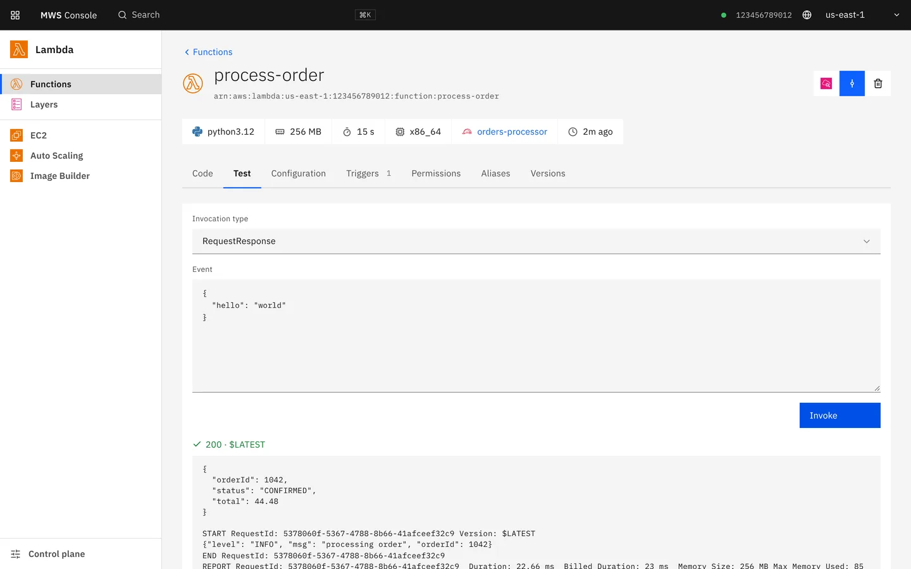</a>
      <br><b>Lambda that runs</b>
      <br><sub>Functions execute in AWS's runtime images and log to CloudWatch.</sub>
    </td>
  </tr>
  <tr>
    <td width="33%" valign="top">
      <a href="docs/screenshots/ec2.webp">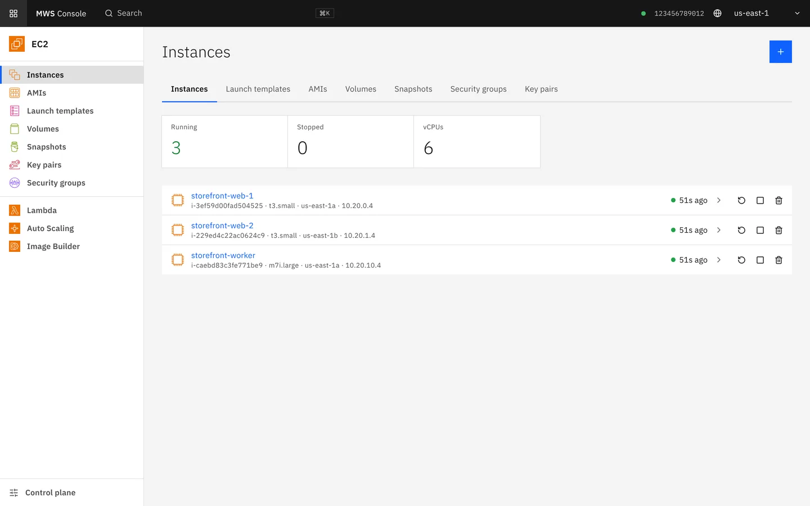</a>
      <br><b>EC2</b>
      <br><sub>Instances with lifecycle states, and real containers when Docker is up.</sub>
    </td>
    <td width="33%" valign="top">
      <a href="docs/screenshots/vpc-map.webp">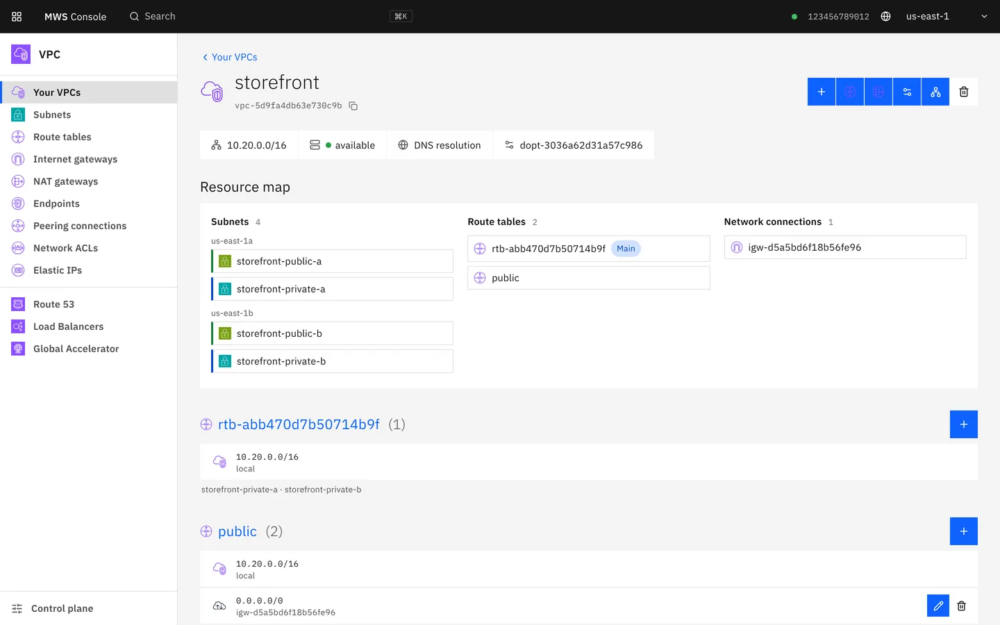</a>
      <br><b>VPC resource map</b>
      <br><sub>Subnets, route tables and gateways, with routing enforced in Docker.</sub>
    </td>
    <td width="33%" valign="top">
      <a href="docs/screenshots/route53.webp">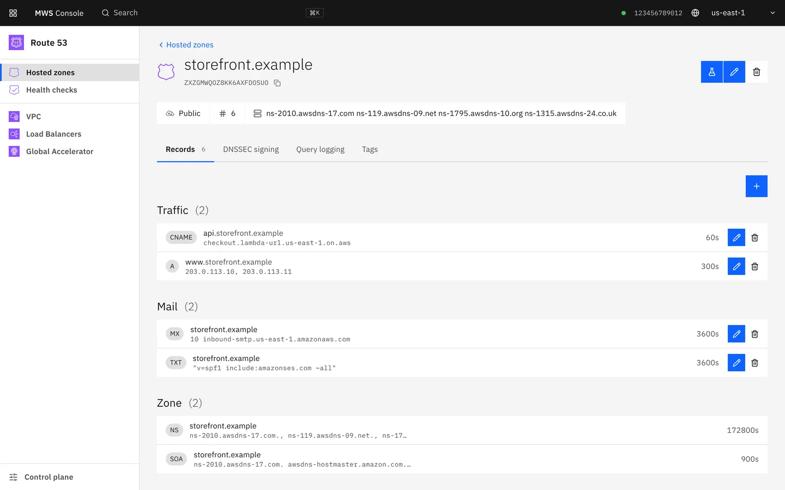</a>
      <br><b>Route 53</b>
      <br><sub>Hosted zones and record sets, optionally served over real DNS.</sub>
    </td>
  </tr>
  <tr>
    <td width="33%" valign="top">
      <a href="docs/screenshots/s3-bucket.webp">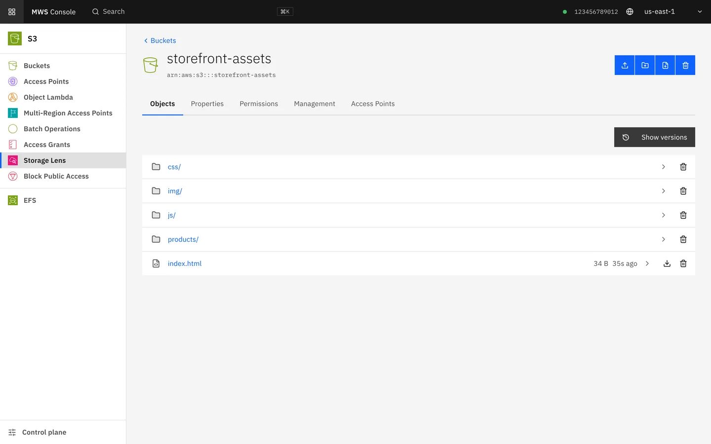</a>
      <br><b>S3</b>
      <br><sub>Buckets with versioning, SSE-KMS, lifecycle rules and notifications.</sub>
    </td>
    <td width="33%" valign="top">
      <a href="docs/screenshots/sqs-queue.webp">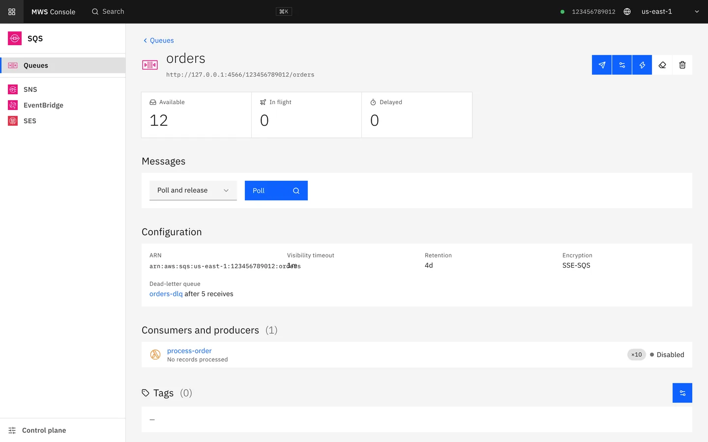</a>
      <br><b>SQS</b>
      <br><sub>Queues with dead-letter redrive and Lambda event source mappings.</sub>
    </td>
    <td width="33%" valign="top">
      <a href="docs/screenshots/metrics.webp">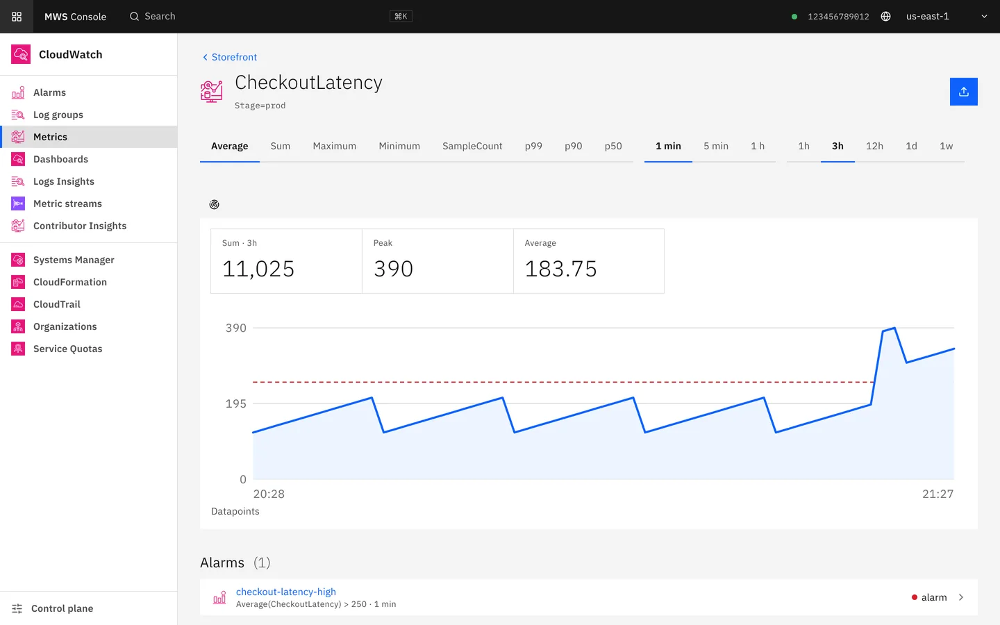</a>
      <br><b>CloudWatch metrics</b>
      <br><sub>Every statistic and period, with alarm thresholds drawn in.</sub>
    </td>
  </tr>
  <tr>
    <td width="33%" valign="top">
      <a href="docs/screenshots/alarms.webp">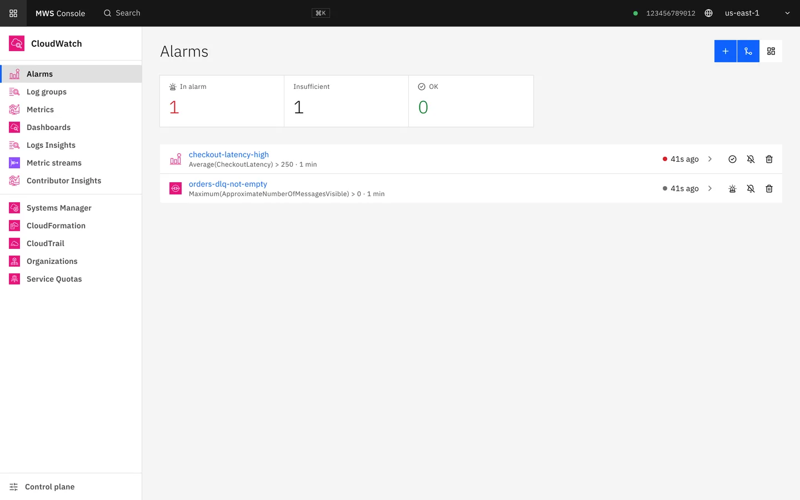</a>
      <br><b>Alarms</b>
      <br><sub>Evaluated on the emulated clock and delivered through SNS.</sub>
    </td>
    <td width="33%" valign="top">
      <a href="docs/screenshots/logs.webp">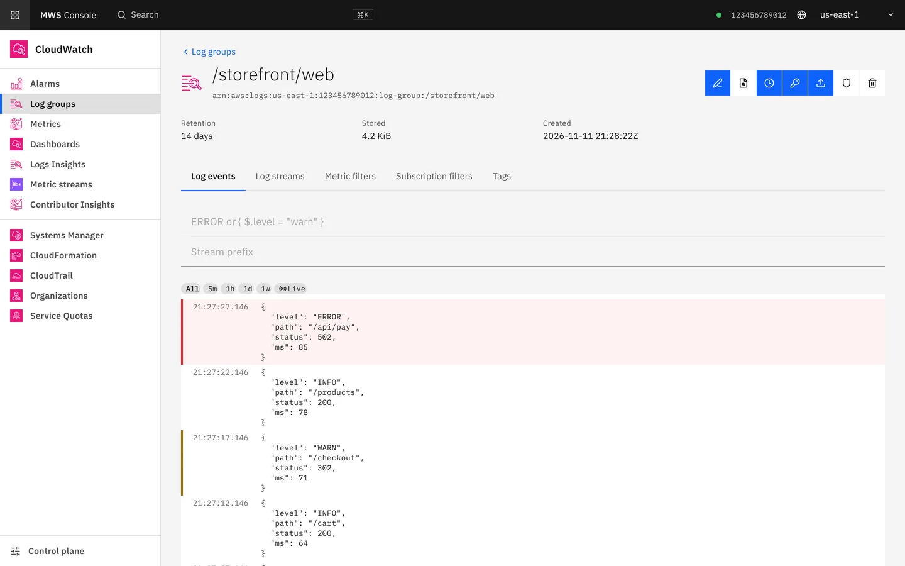</a>
      <br><b>CloudWatch Logs</b>
      <br><sub>Structured log events with filter patterns, live tail and Insights.</sub>
    </td>
    <td width="33%" valign="top">
      <a href="docs/screenshots/cloudformation.webp">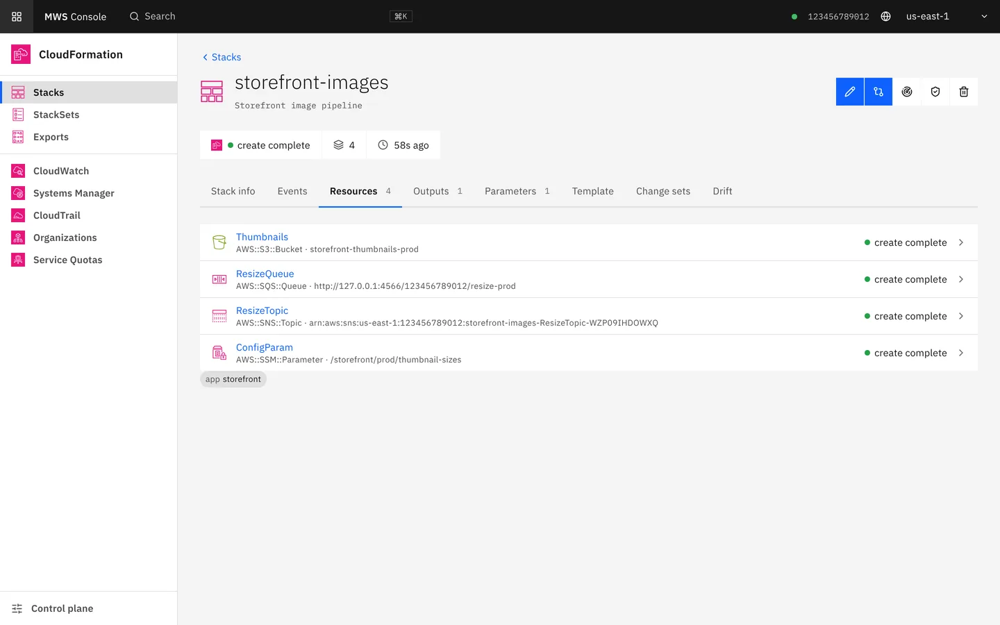</a>
      <br><b>CloudFormation</b>
      <br><sub>Templates deploy real resources across services, with drift and change sets.</sub>
    </td>
  </tr>
  <tr>
    <td width="33%" valign="top">
      <a href="docs/screenshots/bedrock.webp">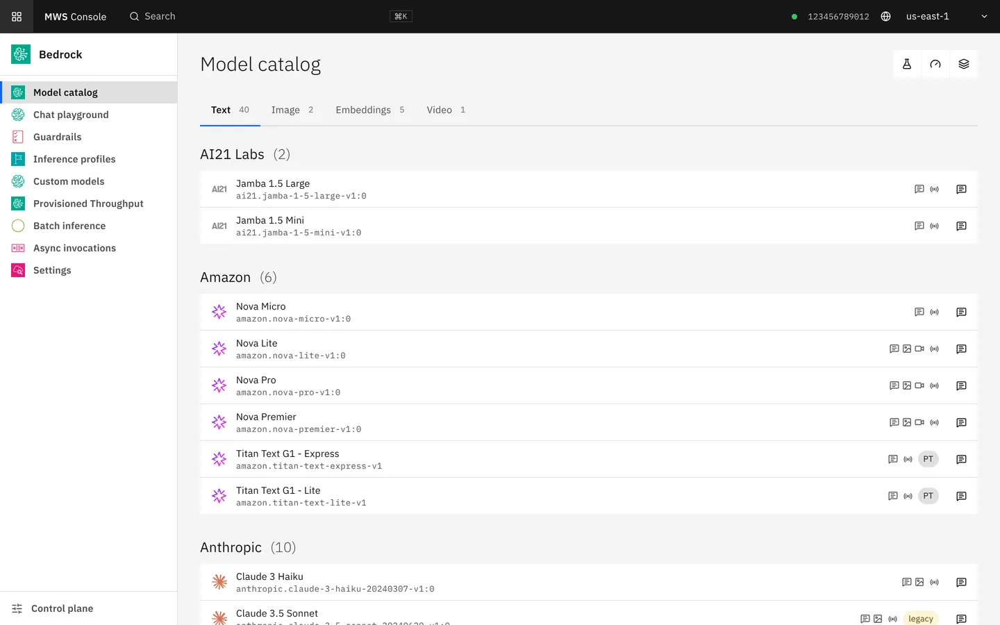</a>
      <br><b>Bedrock</b>
      <br><sub>The model catalog, a playground, guardrails and a pluggable backend.</sub>
    </td>
    <td width="33%" valign="top">
      <a href="docs/screenshots/control.webp">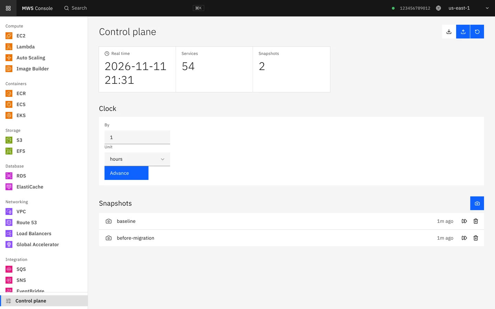</a>
      <br><b>Control plane</b>
      <br><sub>Move the clock, save snapshots, export state and reset.</sub>
    </td>
    <td width="33%" valign="top">
      <a href="docs/screenshots/home-dark.webp">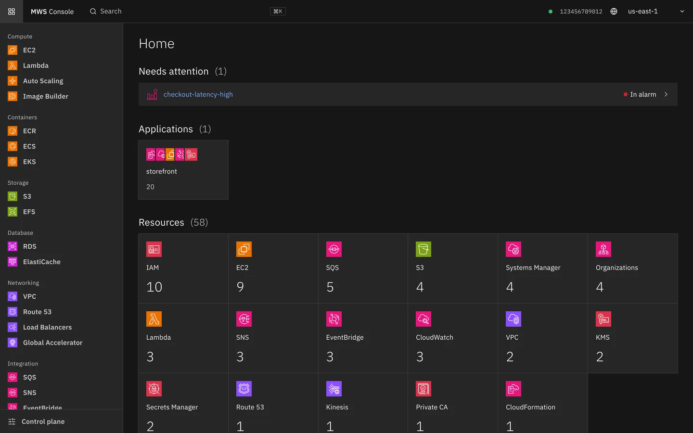</a>
      <br><b>Dark mode</b>
      <br><sub>The whole console follows the system theme.</sub>
    </td>
  </tr>
</table>

## Quickstart

Build and run the emulator (Rust 1.85 or newer):

```sh
git clone https://github.com/terminalsin/mws && cd mws
cargo run --release -p mws      # listens on 0.0.0.0:4566
```

Point the AWS CLI or any SDK at it using the built-in root credentials:

```sh
export AWS_ENDPOINT_URL=http://localhost:4566
export AWS_ACCESS_KEY_ID=AKIAMWSROOTEXAMPLE00
export AWS_SECRET_ACCESS_KEY=mwsRootSecretAccessKeyEXAMPLEKEY00000000
export AWS_REGION=us-east-1 AWS_DEFAULT_REGION=us-east-1

aws sts get-caller-identity
aws iam create-user --user-name alice
aws iam create-access-key --user-name alice   # these keys now authenticate as alice
```

Application code needs no changes. With the environment above, this boto3
snippet talks to MWS, and the same code talks to AWS once the variables
point there:

```python
import boto3

sqs = boto3.client("sqs")
queue = sqs.create_queue(QueueName="orders")["QueueUrl"]
sqs.send_message(QueueUrl=queue, MessageBody="order-1")
print(sqs.receive_message(QueueUrl=queue)["Messages"][0]["Body"])  # order-1
```

See [Getting started](docs/getting-started.md) for the Rust and JavaScript
SDKs, S3 addressing, host-prefixed endpoints and calling as other identities.

To look around in a browser, run the [web console](docs/dashboard.md)
(`cd dashboard && npm ci && npm run dev`, then open http://localhost:3000).
It covers 41 services with the AWS console's layout: ⌘K search across every
resource, create forms that validate as you type and offer repairs,
searchable pickers for roles, keys, queues and the rest, a visual IAM policy
builder, terminals into running instances and containers, and MWS's own
clock, snapshots and reset.

## Supported services

| Service | Operations | Protocol |
| --- | --- | --- |
| [IAM](docs/services/iam.md) | 180 / 180 | awsQuery |
| [STS](docs/services/sts.md) | 11 / 11 | awsQuery |
| [Organizations](docs/services/organizations.md) | 63 / 63 | awsJson 1.1 |
| [IAM Identity Center](docs/services/identity-center.md) (SSO Admin, Identity Store, SSO OIDC, portal) | 109 / 109 | awsJson 1.1, restJson1 |
| [KMS](docs/services/kms.md) | 56 / 56 | awsJson 1.1 |
| [S3](docs/services/s3.md) | 112 / 112 | restXml |
| [S3 Control](docs/services/s3control.md) | 79 / 97 | restXml |
| [Lambda](docs/services/lambda.md) | 88 / 88 | restJson1 |
| [EC2 and VPC](docs/services/ec2.md) | 325 / 811 | ec2Query |
| [EC2 Auto Scaling](docs/services/autoscaling.md) | 68 / 68 | awsQuery |
| [EC2 Image Builder](docs/services/imagebuilder.md) | 77 / 77 | restJson1 |
| [Elastic Load Balancing](docs/services/elb.md) | 80 / 80 | awsQuery |
| [RDS and Aurora](docs/services/rds.md) | 168 / 168 | awsQuery |
| [EKS](docs/services/eks.md) | 70 / 70 | restJson1 |
| [EFS](docs/services/efs.md) | 31 / 31 | restJson1 |
| [ECR](docs/services/ecr.md) | 62 / 62 | awsJson 1.1, Docker registry v2 |
| [ECR Public](docs/services/ecr-public.md) | 23 / 23 | awsJson 1.1, Docker registry v2 |
| [ElastiCache](docs/services/elasticache.md) | 77 / 77 | awsQuery |
| [ECS](docs/services/ecs.md) | 88 / 88 | awsJson 1.1 |
| [Route 53](docs/services/route53.md) | 71 / 71 | restXml |
| [Amplify Hosting](docs/services/amplify.md) | 37 / 37 | restJson1 |
| [Global Accelerator](docs/services/globalaccelerator.md) | 56 / 56 | awsJson 1.1 |
| [Private CA](docs/services/acm-pca.md) | 23 / 23 | awsJson 1.1 |
| [Certificate Manager (ACM)](docs/services/acm.md) | 40 / 40 | awsJson 1.1 |
| [GuardDuty](docs/services/guardduty.md) | 102 / 102 | restJson1 |
| [Connector for SCEP](docs/services/pca-connector-scep.md) | 12 / 12 | restJson1 |
| [Resource Access Manager](docs/services/ram.md) | 35 / 35 | restJson1 |
| [Security Hub](docs/services/securityhub.md) | 126 / 126 | restJson1 |
| [Secrets Manager](docs/services/secretsmanager.md) | 23 / 23 | awsJson 1.1 |
| [Systems Manager](docs/services/ssm.md) | 152 / 152 | awsJson 1.1 |
| [SQS](docs/services/sqs.md) | 23 / 23 | awsJson 1.0, awsQuery |
| [SNS](docs/services/sns.md) | 42 / 42 | awsQuery |
| [SES v1 and v2](docs/services/ses.md) | 187 / 187 | awsQuery, restJson1 |
| [EventBridge](docs/services/events.md) | 57 / 57 | awsJson 1.1 |
| [Kinesis Data Streams](docs/services/kinesis.md) | 45 / 45 | awsJson 1.1 |
| [Firehose](docs/services/firehose.md) | 12 / 12 | awsJson 1.1 |
| [CloudWatch](docs/services/cloudwatch.md) | 55 / 55 | RPC v2 CBOR, awsJson 1.0, awsQuery |
| [CloudWatch Logs](docs/services/logs.md) | 118 / 118 | awsJson 1.1 |
| [Marketplace Metering and Entitlement](docs/services/marketplace.md) | 5 / 5 | awsJson 1.1, RPC v2 CBOR |
| [CodeArtifact](docs/services/codeartifact.md) | 48 / 48 | restJson1, npm, PyPI, Maven, Cargo, RubyGems, NuGet, Swift |
| [CloudTrail](docs/services/cloudtrail.md) | 61 / 61 (with CloudTrail Data) | awsJson 1.1, restJson1 |
| [Service Quotas](docs/services/servicequotas.md) | 26 / 26 | awsJson 1.1 |
| [Cost Explorer](docs/services/ce.md) | 47 / 47 | awsJson 1.1 |
| [CloudFormation](docs/services/cloudformation.md) | 90 / 90 | awsQuery |
| [Bedrock and Bedrock Runtime](docs/services/bedrock.md) | 118 / 119 | restJson1 |

Operations outside the implemented set answer `NotImplemented`: EC2's
unlisted operations, S3 Control's Outposts bucket operations and Bedrock
Runtime's `InvokeModelWithBidirectionalStream`. Each service page lists what
is emulated and its known gaps.

## How it works

```
 AWS SDK / CLI ──HTTP──▶ mws-server ──▶ SigV4 ──▶ route by signing name ──▶ service crate
                          (/_mws API)            (mws-sigv4)                    │
                                                                                 ├─ generated wire layer (Smithy → Rust)
                                                                                 ├─ ctx.authorize(...) → IAM policy engine
                                                                                 └─ service behaviour + state
```

`mws-codegen` turns each service's vendored Smithy model into request and
response types, a router, validators and serializers at build time. Service
crates implement the generated `Handler` trait, and every handler authorizes
the call through the IAM engine before acting. Read more in
[Architecture](docs/architecture.md) and
[Authentication and authorization](docs/security.md).

## Testing your code with MWS

A typical suite starts MWS once with a seed scenario and resets it before each
test:

```sh
MWS_SCENARIO=examples/scenario.json cargo run --release -p mws &
curl -X POST http://localhost:4566/_mws/reset      # before each test
```

The `/_mws` control API also exports and imports state, saves and restores
snapshots, and moves the emulated clock so that lifecycle rules, alarms,
rotations and expiries happen on demand. See
[State, scenarios and snapshots](docs/state.md) and
[Testing](docs/testing.md). The
[TypeScript example apps](tests/e2e-ts) show complete applications tested this
way.

## Configuration

The most common settings (all optional):

| Variable | Default | Purpose |
| --- | --- | --- |
| `MWS_LISTEN` | `0.0.0.0:4566` | Address to listen on |
| `MWS_ACCOUNT_ID` | `123456789012` | The root account's id |
| `MWS_DB` | unset (in memory) | SQLite file to persist state across restarts |
| `MWS_SCENARIO` | unset | Scenario run at startup; becomes the reset baseline |
| `MWS_ASYNC_DELAY_MS` | `500` | How long asynchronous work stays pending; `0` settles it inside the call |
| `MWS_EC2_BACKEND`, `MWS_RDS_BACKEND`, ... | `auto` | Run instances, databases, caches and clusters in Docker when a daemon answers |
| `RUST_LOG` | `info` | Log filter |

All variables are listed in [Configuration](docs/configuration.md).

## Project status

MWS is under active development. Every implemented operation of every service
is exercised by an end-to-end SDK test, and behaviour is audited against real
AWS responses. Known differences from AWS are listed on each
[service page](docs/services/README.md). Bug reports that show MWS answering
differently from AWS are especially welcome.

MWS is a local test tool. Its control API is unauthenticated: do not expose
the port beyond your machine or CI runner.

## Contributing

Contributions are welcome. Please read [CONTRIBUTING.md](CONTRIBUTING.md) for
the design rules, how to add a service, and the checks every change must pass.

## License

Licensed under either of [Apache License, Version 2.0](LICENSE-APACHE) or
[MIT license](LICENSE-MIT) at your option.

Unless you explicitly state otherwise, any contribution intentionally
submitted for inclusion in MWS by you, as defined in the Apache-2.0 license,
shall be dual licensed as above, without any additional terms or conditions.

MWS is not affiliated with or endorsed by Amazon Web Services. AWS and the
names of AWS services are trademarks of Amazon.com, Inc. or its affiliates.
